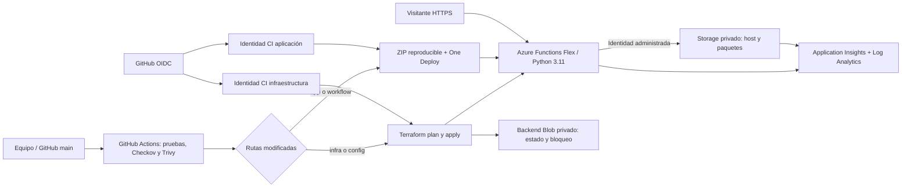

# Hugo, Paco y Luis · Misión serverless

Segundo parcial de **Infraestructura para TI**, Universidad Tecnológica de Bolívar. **Taller 4: API serverless con Azure Functions**, según la asignación de la página 1 y las actividades de la página 7 del enunciado.

La API responde en JSON y texto, valida solicitudes y muestra su versión y commit. Terraform define la infraestructura; GitHub Actions prueba, analiza y publica los cambios automáticamente.

- [Repositorio](https://github.com/IsaacDev2024/hugo-paco-luis-serverless)
- [Ejecuciones y evidencias de CI/CD](https://github.com/IsaacDev2024/hugo-paco-luis-serverless/actions)
- [Aplicación publicada](https://func-hpl-dev-a7d0f782.azurewebsites.net/) · [Salud y versión](https://func-hpl-dev-a7d0f782.azurewebsites.net/api/health).
- URL publicada y resultados verificados: [evidence/status.json](evidence/status.json).
- Cobertura de la evaluación: [docs/rubrica.md](docs/rubrica.md).
- Decisiones, excepciones y mejoras: [docs/decisiones.md](docs/decisiones.md).

## Equipo

Isaac David Sánchez Sánchez ([IsaacDev2024](https://github.com/IsaacDev2024)), Santiago Andrés Orejuela Cueter ([sorejuela](https://github.com/sorejuela)), Luis Mario Díaz Martínez ([Code-LuisDiaz](https://github.com/Code-LuisDiaz)) y Eli Weiman Amaya. Docente: Rafael Enrique Monterroza Barrios.

## Arquitectura



`bootstrap/` crea dos grupos de recursos, el backend remoto y las identidades OIDC. Su estado se conserva **local y fuera de Git** para evitar el problema circular del backend. `infra/` crea Storage, contenedor, identidad de ejecución, rol Blob, plan FC1, Function App, Application Insights, Log Analytics y auditoría de Blob. El backend Azure Blob del estado de `infra/` tiene bloqueo nativo mediante lease y versionado.

No se usa Docker ni Ansible: el taller 4 publica un paquete Python en un servicio administrado. No hay máquina virtual ni base de datos. El portal de prueba se sirve desde la misma Function App.

## Prueba de la aplicación

Sustituir `BASE_URL` por el valor publicado en `evidence/status.json` o `terraform -chdir=infra output -raw base_url`.

```bash
export BASE_URL='https://func-hpl-dev-a7d0f782.azurewebsites.net'
curl --fail-with-body "$BASE_URL/api/health"
curl --fail-with-body "$BASE_URL/api/equipo"
curl --fail-with-body "$BASE_URL/api/saludo?nombre=UTB&personaje=hugo"
curl --fail-with-body "$BASE_URL/api/saludo?nombre=UTB&personaje=paco&formato=texto"
curl --fail-with-body -X POST "$BASE_URL/api/saludo" \
  -H 'Content-Type: application/json' \
  -d '{"nombre":"Equipo UTB","personaje":"luis","formato":"json"}'
# Debe responder HTTP 400 (personaje inválido):
curl -i "$BASE_URL/api/saludo?personaje=desconocido"
python scripts/smoke.py "$BASE_URL"
```

| Ruta | Método | Respuesta |
| --- | --- | --- |
| `/` | GET | Portal HTML de demostración |
| `/api/health` | GET | 200 JSON: estado, versión, commit y ambiente |
| `/api/equipo` | GET | 200 JSON: integrantes y taller |
| `/api/saludo` | GET, POST | 200 JSON o texto; 400 por entrada inválida; 413 por cuerpo >4096 bytes; 415 por POST sin JSON |

`nombre` admite 1-60 caracteres sin controles; `personaje`: hugo, paco o luis; `formato`: json o texto. Todos tienen valor por defecto. POST acepta un objeto JSON y usa sus campos; GET usa la query. La API es pública y anónima por diseño académico, sin operaciones privilegiadas. No enviar datos sensibles. Los logs de aplicación registran un identificador y la versión, nunca el nombre ni el cuerpo. Azure puede registrar metadatos HTTP y URLs; usar POST para evitar nombres en la query de telemetría.

## Requisitos y validación local

Python 3.11, Terraform 1.16.6, Azure CLI, GitHub CLI, Checkov 3.3.29 y Trivy 0.76.0. El proveedor AzureRM 4.81.0 queda fijado en los lockfiles para Linux amd64 y macOS arm64. Las dependencias de ejecución y las acciones de GitHub también están fijadas.

```bash
python3.11 -m venv .venv
source .venv/bin/activate
python -m pip install -r requirements-dev.txt checkov==3.3.29
python -m pytest -q
terraform fmt -check -recursive
terraform -chdir=infra init -backend=false -input=false -lockfile=readonly
terraform -chdir=bootstrap init -input=false -lockfile=readonly
terraform -chdir=infra validate
terraform -chdir=bootstrap validate
terraform -chdir=infra test
checkov -d infra --framework terraform --external-checks-dir security/checkov
checkov -d bootstrap --framework terraform
trivy fs --scanners vuln,secret --severity HIGH,CRITICAL --exit-code 1 .
python scripts/package.py
python scripts/preview.py
```

La vista previa está en `http://127.0.0.1:8765` y ejecuta los handlers Python en un adaptador WSGI; **no reproduce el host de Azure**. Las pruebas `terraform test` usan un proveedor simulado y no crean recursos. Solo `scripts/smoke.py` contra la URL Azure demuestra el funcionamiento público. El ZIP contiene únicamente siete archivos permitidos y `host.json` en la raíz; GitHub inserta el SHA del commit sin modificar las fuentes.

## Despliegue reproducible desde cero

El operador necesita una suscripción activa y permisos para crear recursos y asignaciones de rol (Owner, o Contributor más RBAC Administrator en los ámbitos correspondientes). No se necesita crear una aplicación en Entra ni un secreto de cliente. El repositorio debe existir y pertenecer al operador de `gh`.

```bash
az login
az account list -o table
az account set --subscription 'ID-DE-LA-SUSCRIPCION-DESTINO'
export ARM_SUBSCRIPTION_ID="$(az account show --query id -o tsv)"
# Registrar únicamente los proveedores usados; esperar su estado Registered.
for namespace in Microsoft.Storage Microsoft.Web Microsoft.ManagedIdentity Microsoft.Insights Microsoft.OperationalInsights; do
  az provider register --namespace "$namespace" --wait
done
python scripts/prepare_bootstrap.py
terraform -chdir=bootstrap init -lockfile=readonly
terraform -chdir=bootstrap plan -out=bootstrap.tfplan
terraform -chdir=bootstrap apply bootstrap.tfplan
python scripts/configure_github.py
```

El bootstrap confía exclusivamente en el subject de main obtenido de GitHub. Este repositorio usa IDs inmutables: `repo:IsaacDev2024@158796340/hugo-paco-luis-serverless@1421677306:ref:refs/heads/main`. Para un fork, ejecutar ambos scripts de preparación/configuración con `--repo propietario/repositorio` y conservar el archivo local ignorado `bootstrap/github.auto.tfvars.json`. [Formato de OIDC en GitHub](https://docs.github.com/en/actions/reference/security/oidc). Cada suscripción produce un sufijo de nombres estable y distinto. La configuración del laboratorio utiliza `dev`; para agregar ambientes hay que ampliar también bootstrap, permisos y claves de estado.

**Conservar `bootstrap/terraform.tfstate` en un respaldo privado**: permite actualizar y retirar las identidades y el backend. No subir estados, planes, tokens ni `local.settings.json` a GitHub. Las identidades de CI no tienen permisos sobre toda la suscripción: infraestructura puede administrar recursos y RBAC solo en el grupo del taller; aplicación tiene Website Contributor en ese mismo grupo. Solo infraestructura puede leer/escribir el contenedor de estado.

Tras el bootstrap, una publicación en `main` o una ejecución manual del workflow realiza el primer despliegue:

```bash
gh workflow run ci-cd.yml --ref main -f force_infra=true
gh run list --limit 5
```

La primera propagación de roles puede tardar varios minutos. Si Azure rechaza una operación por RBAC recién asignado, esperar y volver a ejecutar el mismo workflow; Terraform conserva el estado de lo completado. La región de ejemplo es `canadacentral`; confirmar que la política de la suscripción y la cuota Flex permiten esa región. No omitir los controles para resolver un despliegue fallido.

## Configuración y automatización

`config/lab.tfvars` contiene **solo configuración pública** y sí se versiona.

| Variable | Valor inicial | Efecto |
| --- | --- | --- |
| `location` | canadacentral | Región; cambiarla puede reemplazar recursos |
| `environment` | dev | Único ambiente habilitado por el bootstrap |
| `maximum_instance_count` | 2 | Techo de 1-3 instancias, 512 MB cada una |
| `extra_tags` | demonstration=baseline | Etiquetas adicionales; no puede sustituir team/project/environment |

Las variables GitHub son identificadores públicos, no credenciales: `AZURE_SUBSCRIPTION_ID`, `AZURE_TENANT_ID`, `AZURE_INFRA_CLIENT_ID`, `AZURE_APP_CLIENT_ID`, `TF_STATE_ACCOUNT`, `TF_STATE_CONTAINER`, `AZURE_FUNCTIONAPP_NAME`. `scripts/configure_github.py` las obtiene de las salidas de Terraform. OIDC emite tokens temporales por ejecución. La identidad de Functions accede a Storage sin claves de cuenta. `terraform_data.identity_storage` retira el ajuste legado que AzureRM 4.81.0 genera con una clave vacía; se ejecuta mediante Azure CLI después de cada cambio de la Function App. El detalle está en docs/decisiones.md.

En cada push/PR se ejecutan pruebas, Terraform fmt/validate/test, Checkov y Trivy. Un fallo bloquea el despliegue. En `main`, cambios en `app/` empaquetan/publican sin ejecutar Terraform; cambios en `infra/` o `config/` hacen plan/apply antes de publicar y probar la aplicación. Cambios de documentación solo validan. Los PR no reciben OIDC ni despliegan. Las ejecuciones por rama se serializan y no se cancelan durante un apply. La comprobación pública exige que el SHA servido coincida con el commit del workflow.

## Evidencias y operación

Cada ejecución conserva artefactos `validacion-SHA`, `infraestructura-SHA` y `aplicacion-SHA` por 30 días. Guardar las evidencias antes de que expiren. `evidence/` conserva una selección descargada y el estado de la entrega; los archivos locales no sustituyen evidencias de nube. Los planes binarios y estados nunca se suben como artefactos. Los logs de plan/apply muestran valores sensibles enmascarados por Terraform.

En Application Insights, consultar `requests | order by timestamp desc | take 20` y `traces | where message contains "greeting_success" | order by timestamp desc`. Hay muestreo, por lo que no se promete una traza por cada saludo. La auditoría Blob envía StorageRead/Write/Delete al workspace. La telemetría puede tardar unos minutos en aparecer.

Sin instancias always-ready, Functions puede escalar a cero; hay arranque en frío. Se limita a dos instancias, tiempo de función de 30 s, concurrencia HTTP de cuatro por instancia y datos de logs a 0.1 GB/día con retención de 30 días. Storage usa Standard LRS. **Estos límites reducen consumo y no son un tope de facturación**: Azure puede cobrar ejecuciones, almacenamiento, operaciones y telemetría; algunos límites de ingestión no cortan inmediatamente. Revisar Cost Management y destruir después de la evaluación. [Opciones de hosting y facturación de Functions](https://learn.microsoft.com/azure/azure-functions/functions-scale).

## Destruir y comprobar

Primero guardar las evidencias. El workflow `destroy.yml` es manual y exige escribir `DESTRUIR-HPL`; destruye la carga del taller, conserva el backend y no vuelve a publicar la API.

```bash
gh workflow run destroy.yml --ref main -f confirmation=DESTRUIR-HPL
```

También se puede usar el backend existente como operador autenticado:

```bash
export ARM_SUBSCRIPTION_ID="$(az account show --query id -o tsv)"
python scripts/configure_github.py --backend-only
python scripts/grant_operator.py
terraform -chdir=infra init -reconfigure -backend-config=backend.hcl
terraform -chdir=infra plan -destroy -var-file=../config/lab.tfvars -out=destroy.tfplan
terraform -chdir=infra apply destroy.tfplan
terraform -chdir=infra state list
az resource list --resource-group rg-hpl-parcial-dev -o table
# Solo después de destruir la carga y respaldar el estado privado:
terraform -chdir=bootstrap plan -destroy -out=destroy.tfplan
terraform -chdir=bootstrap apply destroy.tfplan
az group exists --name rg-hpl-parcial-dev
az group exists --name rg-hpl-terraform-state
```

El resultado esperado es estado de carga vacío y, tras retirar bootstrap, ambos grupos inexistentes. La destrucción completa requiere los permisos del operador, no los limitados de CI. Azure puede conservar datos bajo sus políticas de borrado lógico. No eliminar primero el backend: se perdería el estado necesario para retirar la carga.

## Referencias técnicas

- [Microsoft: Terraform para Functions Flex](https://learn.microsoft.com/azure/azure-functions/functions-create-first-function-terraform).
- [Microsoft: conexiones mediante identidad administrada](https://learn.microsoft.com/azure/azure-functions/functions-identity-based-connections-tutorial).
- [Azure Functions Action: OIDC y compilación remota](https://github.com/Azure/functions-action).
- [Proveedor AzureRM: recurso Flex Consumption](https://registry.terraform.io/providers/hashicorp/azurerm/4.81.0/docs/resources/function_app_flex_consumption).
